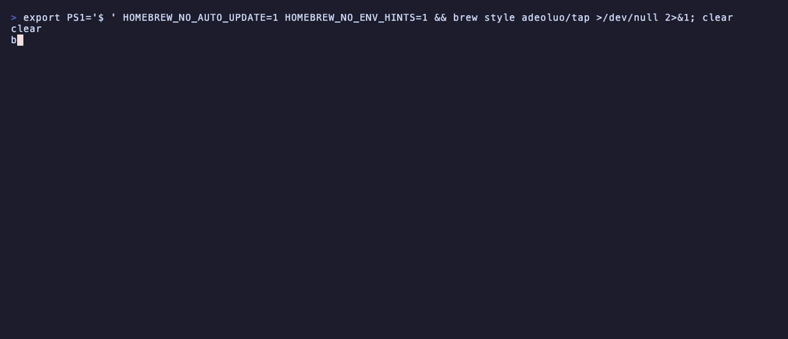
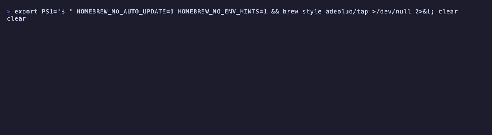

<h1 align="center">Homebrew Tap</h1>

<p align="center">
  <em>Homebrew formulas for command-line tools by Adeolu Ogunnoiki.</em>
</p>

<p align="center">
  <a href="https://github.com/adeoluo/homebrew-tap/actions/workflows/ci.yml"></a>
  
  <a href="LICENSE"></a>
</p>

---

## Formulas

| Formula | Tool | Install |
|---|---|---|
| `vectordb` | [vectordb-go](https://github.com/adeoluo/vectordb-go): a concurrent, persistent HNSW vector database server with write-ahead log crash recovery | `brew install adeoluo/tap/vectordb` |
| `agent-sandbox` | [agent-sandbox](https://github.com/adeoluo/agent-sandbox): a policy-based sandbox for running AI agent tool calls (built from source with Rust) | `brew install adeoluo/tap/agent-sandbox` |
| `corpus-dedup` | [corpus-dedup-library](https://github.com/adeoluo/corpus-dedup-library): removes near-duplicate lines from JSONL corpora with MinHash and LSH (built from source with Rust) | `brew install adeoluo/tap/corpus-dedup` |
| `profile-forge` | [profile-forge](https://github.com/adeoluo/profile-forge): generates a GitHub profile README from live repository metadata | `brew install adeoluo/tap/profile-forge` |

## Usage

```bash
brew tap adeoluo/tap
brew trust --tap adeoluo/tap   # Homebrew 7 and later require trusting third-party taps
brew install vectordb agent-sandbox corpus-dedup profile-forge
```

Prebuilt binaries are used for macOS and Linux on arm64 and amd64 where a release provides them;
`agent-sandbox` and `corpus-dedup` compile from the tagged source release.

### Demos

Recorded from real runs with [vhs](https://github.com/charmbracelet/vhs); each tape is in `docs/demo/`.

Installing from the tap and running the installed tools.

<p align="center">
  
</p>

The tap's formulae and a clean style check.

<p align="center">
  
</p>

Running a formula's test block against the installed binary.

<p align="center">
  
</p>

## Testing

CI runs `brew style` and `brew audit` on every formula, then installs each one and runs its
`brew test` block on macOS.

## License

Released under the [MIT License](LICENSE).
